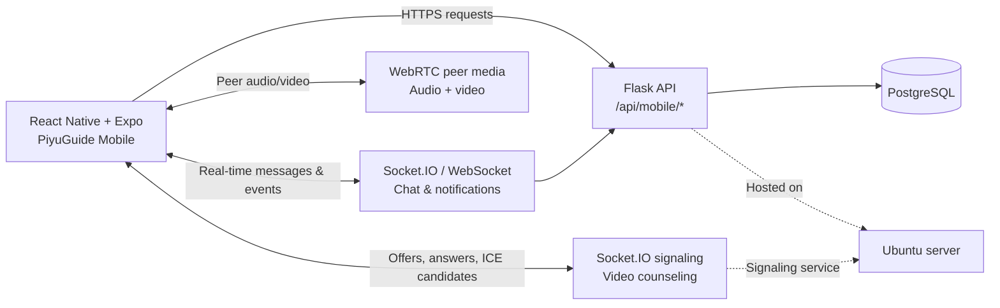

<div align="center">

# 📱 PiyuGuide Mobile Application

### A React Native companion for university inquiries, counseling, chat, and video sessions

[](https://reactnative.dev/)
[](https://expo.dev/)
[](https://flask.palletsprojects.com/)
[](https://www.postgresql.org/)
[](https://webrtc.org/)
[](https://socket.io/)
[](#-project-status)

</div>

> **Portfolio project by Gerald Pandaan** — BS Information Technology graduate, Cum Laude.

## 📌 Table of Contents

- [About](#-about)
- [Screenshots / Demo](#-screenshots--demo)
- [Key Features](#-key-features)
- [Tech Stack](#-tech-stack)
- [System Architecture](#-system-architecture)
- [Getting Started](#-getting-started)
- [Project Structure](#-project-structure)
- [Related Repositories](#-related-repositories)
- [Project Status](#-project-status)
- [Author](#-author)

## 💡 About

PiyuGuide helps students get university inquiries and counseling support without needing to navigate disconnected channels. This mobile application provides a focused student experience for selecting a campus, contacting university offices, tracking conversations, requesting counseling sessions, and joining video appointments.

It connects to the same Flask backend used by the PiyuGuide web platform. That backend uses PostgreSQL for application data and Socket.IO/WebRTC flows for real-time chat and counseling calls.

## 🖼️ Screenshots / Demo

Replace the placeholder paths below with exported screenshots or a demo recording.

| Welcome & campus selection | Inquiry inbox | Chat with an office |
|---|---|---|
|  |  |  |

| Counseling sessions | Video counseling call | Profile & notifications |
|---|---|---|
|  |  |  |

## ✨ Key Features

### 🎓 Student experience

- Campus selection with campus-specific departments and onboarding flow
- Student registration, login, session restoration, and profile details
- Submit inquiries to university offices with concern types and descriptions
- View inquiry status, latest message previews, and conversation history
- Real-time office chat with typing indicators and file attachments
- Push-style in-app notification updates and unread counts
- Browse counseling offices and available appointment slots
- Request, review, cancel, and provide feedback for counseling sessions
- Join video counseling sessions with microphone, camera, speaker, reconnection, and connection-quality controls
- Light/dark interface support and responsive animated screens

### 🧑‍💼 Connected platform roles

Counselors and university staff participate through the shared backend and the related web application. The mobile repository itself currently exposes the student-facing screens and workflows; separate counselor/admin mobile screens are not present in this codebase.

## 🧰 Tech Stack

| Area | Technologies |
|---|---|
| Mobile | React Native, TypeScript, Expo, Expo Dev Client, NativeWind, React Native Reanimated |
| Backend | Flask API, shared with the PiyuGuide web application |
| Database | PostgreSQL, accessed by the backend |
| Real-time | Socket.IO/WebSocket for chat, notifications, signaling, and session events; `react-native-webrtc` for peer media |
| Deployment | Android native build configuration; backend hosted on an Ubuntu server |

## 🏗️ System Architecture



## 🚀 Getting Started

### Prerequisites

- Node.js and npm
- Android Studio and an Android device/emulator for native development
- Expo CLI through `npx`
- A reachable PiyuGuide Flask backend
- Camera and microphone permissions for video counseling

Because this app uses native modules such as `react-native-webrtc` and `expo-dev-client`, use an Expo development build or a native Android run rather than relying only on Expo Go.

### 1. Clone and install

```bash
git clone https://github.com/Eraal/PiyuGuide---Mobile-Application.git
cd PiyuGuide---Mobile-Application
npm install
```

### 2. Configure the backend URL

The app reads `EXPO_PUBLIC_PIYUGUIDE_BACKEND_URL`. If it is not set, the code falls back to `https://piyuguide.live`.

Create a local `.env` file from the included template:

```bash
cp .env.example .env
```

Then replace the example value with the URL reachable from your emulator or device. For example, an Android emulator commonly reaches a host machine through `http://10.0.2.2:<port>`. Do not commit `.env`; environment files are ignored by this repository.

### 3. Start the app

Start the Expo development server:

```bash
npx expo start
```

Build and run the Android development client:

```bash
npx expo run:android
```

The package also provides these scripts:

```bash
npm run start
npm run android
npm run ios
npm run web
```

> **Backend note:** the mobile client expects the Flask service to expose the `/api/mobile/*` routes and Socket.IO namespaces used by `src/services/backend.ts`, `src/services/chatSocket.ts`, and `src/services/videoSocket.ts`.

## 🗂️ Project Structure

<details>
<summary>Expand the main folder tree</summary>

```text
PiyuGuide---Mobile-Application/
├── App.tsx                    # Root entry point
├── app.json                   # Expo app configuration and Android permissions
├── eas.json                   # Development, preview, and production build profiles
├── global.css                 # NativeWind entry stylesheet
├── package.json               # Scripts and dependencies
├── android/                   # Generated/native Android project
└── src/
    ├── app/
    │   └── App.tsx            # Screen state and application flow
    ├── components/            # Shared UI, chat, counseling, and auth components
    ├── constants/             # Backend URL, chat, brand, campus, and theme constants
    ├── hooks/                 # Lifecycle, animation, permissions, and WebRTC hooks
    ├── screens/               # Auth, inquiries, chat, counseling, profile, and call screens
    ├── services/
    │   ├── backend.ts         # REST API client and response mapping
    │   ├── chatSocket.ts      # Real-time inquiry chat events
    │   └── videoSocket.ts     # Counseling signaling and session events
    ├── theme/                 # Colors, theme context, and shared theme exports
    └── types/                 # Shared TypeScript types
```

</details>

## 🔗 Related Repositories

- **[PiyuGuide Web Application](https://github.com/Eraal/PiyuGuide)** — the original capstone web version.

Both clients use the same Flask backend and PostgreSQL data model. The mobile app provides a React Native/Expo student experience while the web application covers the broader browser-based platform.

## 📍 Project Status

This is a portfolio and capstone project. The demo backend may be offline or unavailable at times, so live authentication, chat, notifications, and calls may not work continuously. The application is not currently published on the Google Play Store. A repository license file has not been specified yet.

## 👤 Author

**Gerald Pandaan** — BS Information Technology graduate, Cum Laude  
GitHub: [@Eraal](https://github.com/Eraal) · [LinkedIn](https://linkedin.com/in/gerald-pandaan-27b53b2a9/) · [Portfolio](https://my-portfolio-livid-tau-gerald.vercel.app) · [Email](mailto:geraldnazpandaan1@gmail.com)
